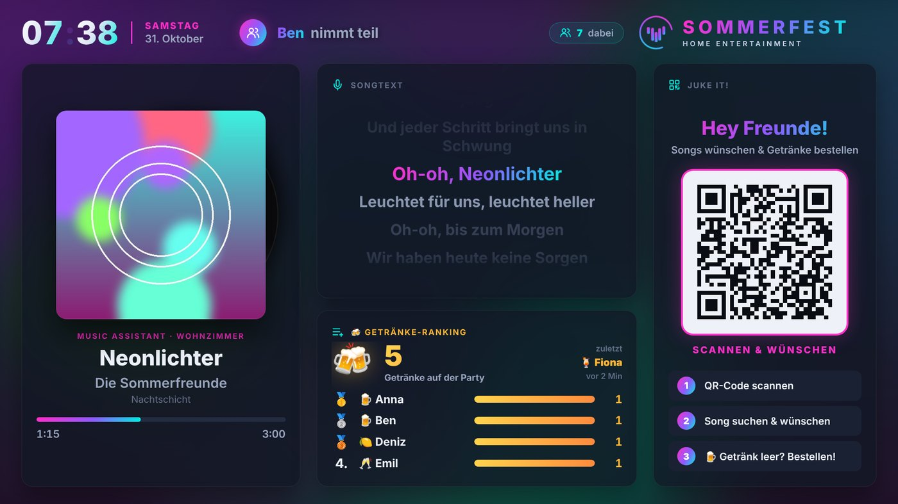
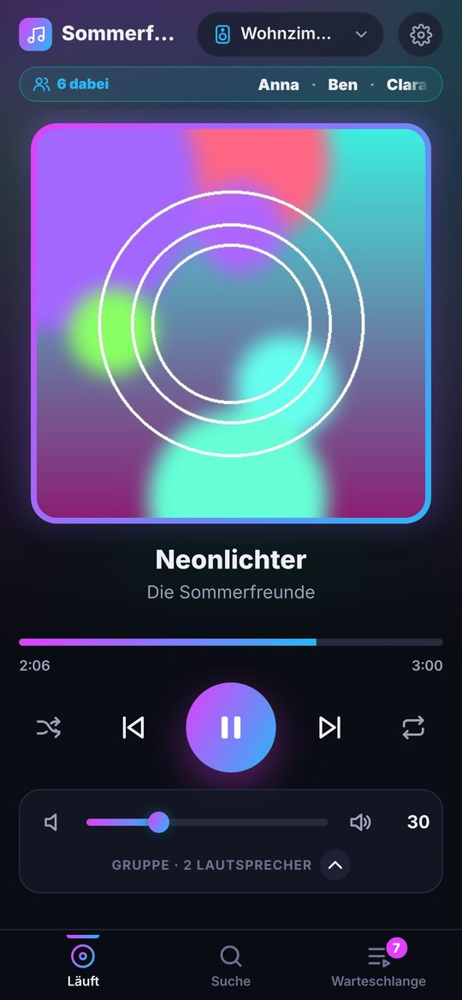
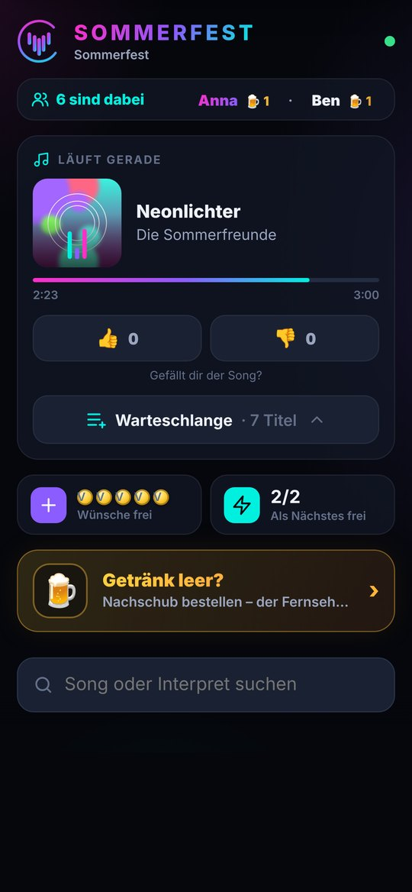
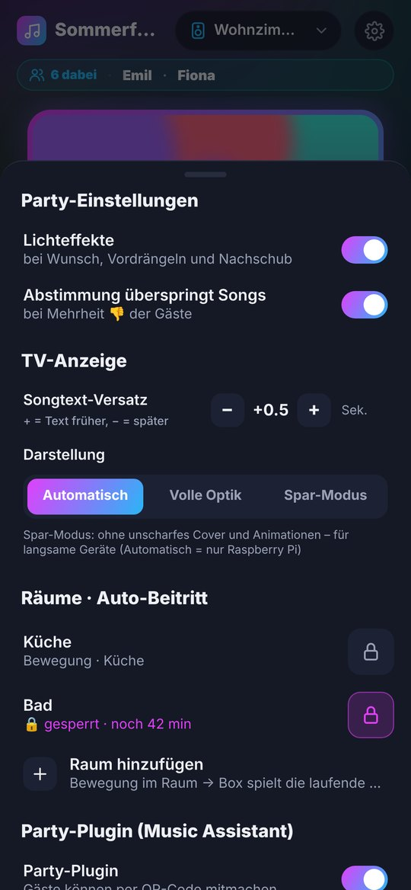
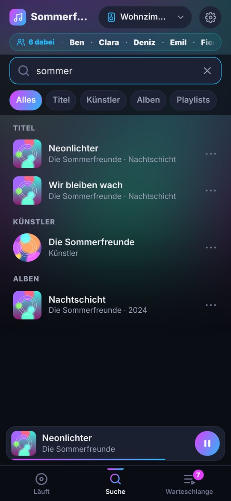
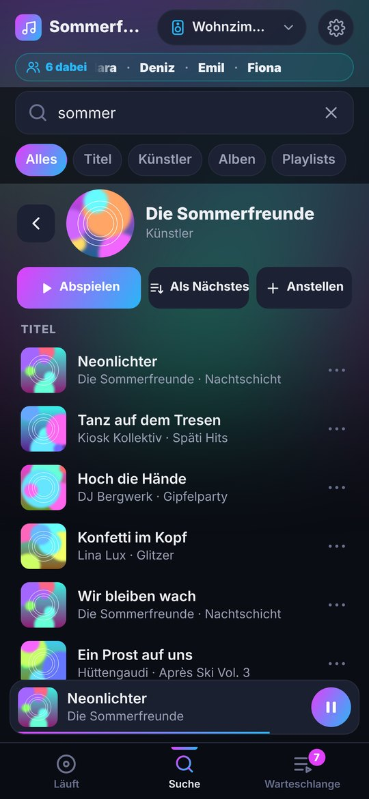
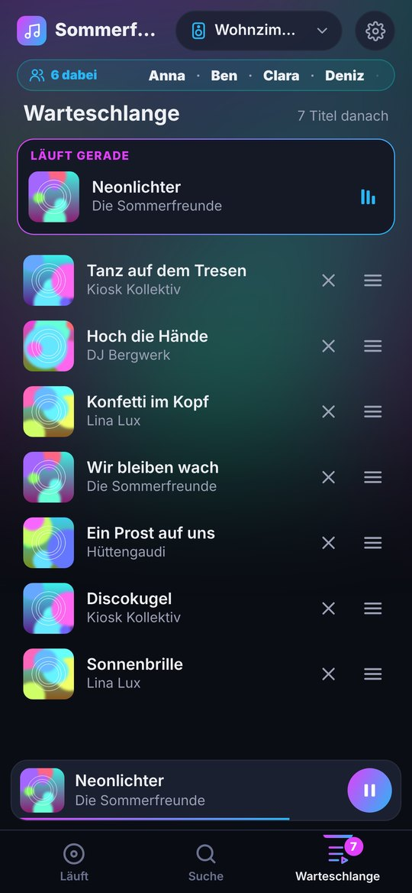
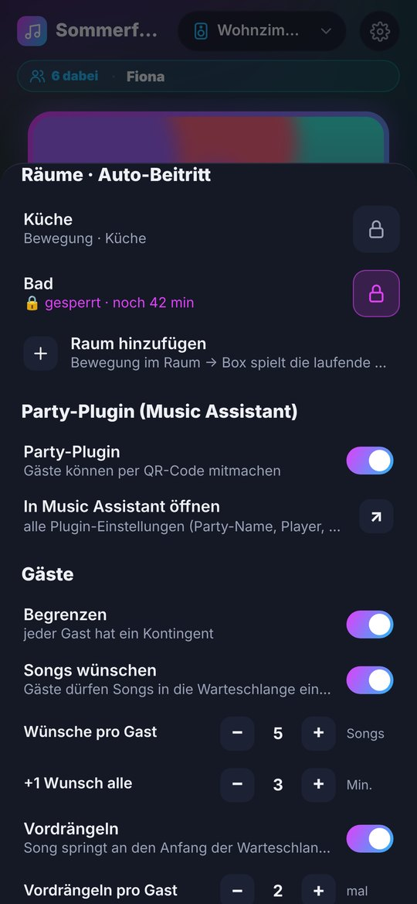
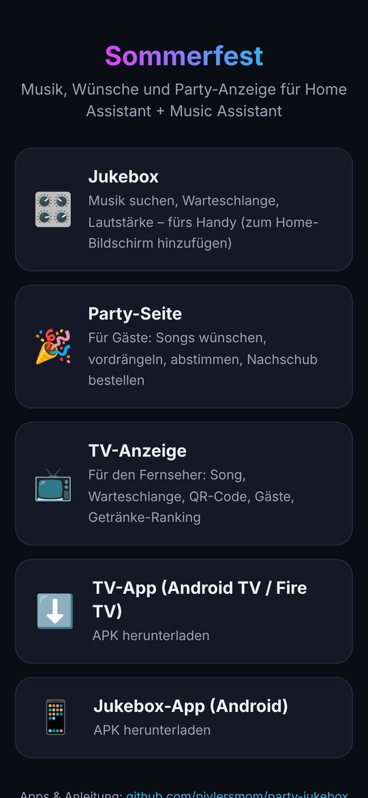

# 🎉 Party-Jukebox

Home-Assistant-Add-on für Partys und den Alltag mit **Music Assistant**: eine Jukebox fürs Handy, eine Party-Seite für Gäste und eine Anzeige für den Fernseher – alles aus einem Add-on, ohne YAML.

  

| Jukebox | Party-Seite (Gäste) | Einstellungen |
|:---:|:---:|:---:|
|  |  |  |

---

## Was kann es?

### 🎛️ Jukebox (für dich)
- Suchen nach Titeln, Künstlern, Alben und Playlists. Künstler, Alben und Playlists lassen sich öffnen und durchklicken.
- Warteschlange: Titel per Griff ≡ verschieben, entfernen, Titel als Nächstes einreihen
- Lautsprecher wählen und gruppieren; die Lautstärke regelst du für die ganze Gruppe oder für jede Box einzeln.
- **Cover antippen** → Songtext läuft mit · **Cover lange drücken** → laufender Titel zu den Favoriten (Rahmen im Farbverlauf)
- Teilnehmer-Laufband: wer gerade auf der Party ist
- In der Android-App: Player in der Benachrichtigung und auf dem Sperrbildschirm, Lautstärketasten regeln die Musik

| Suche | Künstler | Warteschlange |
|:---:|:---:|:---:|
|  |  |  |

### 🥳 Party-Seite (für Gäste)
Gäste scannen den QR-Code auf dem Fernseher und können:
- Songs wünschen (mit Widmung „für …“), sich vordrängeln
- über den laufenden Song abstimmen (👎-Mehrheit überspringt)
- Getränke-Nachschub bestellen – auf Wunsch kommt eine Nachricht aufs Handy

### 📺 TV-Anzeige
Aktueller Song mit Songtext (zeitgenau), Warteschlange, „Als Nächstes“, QR-Code, neue Gäste, Getränke-Ranking und Nachschub-Hinweise.

### ⚙️ Einstellungen direkt in der Jukebox
Zahnrad oben rechts:
- **Lichteffekte** an/aus (eigene HA-Skripte bei Wunsch, Vordrängeln, Nachschub – [Vorlagen](lichteffekte/))
- **Abstimmung** an/aus, **Gast-Limits** (Wünsche und Vordrängeln pro Gast, Nachfüllzeit)
- **TV-Anzeige**: Songtext-Versatz, volle Optik oder Spar-Modus für langsame Geräte
- **Räume · Auto-Beitritt**: Lautsprecher + Bewegungsmelder je Raum – wer den Raum betritt, hört die laufende Musik mit, ohne Bewegung trennt sich die Box wieder. Sperre per Schloss (mit Restzeit), optional über einen eigenen HA-Schalter (z. B. für Alexa)
- **Party-Plugin** von Music Assistant installieren, ein- und ausschalten

---

## Voraussetzungen

- Home Assistant OS oder Supervised (Add-ons müssen möglich sein)
- [Music Assistant](https://www.music-assistant.io/) ab 2.x als Add-on
- Lautsprecher, die in Music Assistant eingebunden sind (Sonos, AirPlay, Chromecast …)

## Installation

1. In Home Assistant: **Einstellungen → Add-ons → Add-on Store → ⋮ → Repositories**
2. URL hinzufügen: `https://github.com/pivlersmom/party-jukebox`
3. **Party-Jukebox** installieren
4. Im Reiter **Konfiguration** den **Music-Assistant-Token** eintragen
   (Music Assistant → Einstellungen → Profil → Token erstellen)
5. Add-on starten → **Web-UI öffnen** (oder im Heimnetz `http://<HA-IP>:8099`)
6. In der Jukebox ⚙ → **Party-Plugin → Installieren** (für QR-Code und Gäste-Anmeldung)

## Optionen (Add-on-Konfiguration)

| Option | Bedeutung |
|---|---|
| `ma_url` | Leer lassen = Music-Assistant-Add-on wird automatisch gefunden |
| `ma_token` | Token aus Music Assistant (Pflicht) |
| `party_name` | Titel auf TV und Party-Seite |
| `party_player` | MA-Player für die Party (leer = der gerade spielende) |
| `notify_service` | z. B. `notify.mobile_app_mein_iphone` – Nachschub-Bestellungen aufs Handy/die Uhr, Android und iPhone; mehrere mit Komma trennen (leer = aus) |
| `script_wish` / `script_boost` / `script_drink` | Optionale HA-Skripte, z. B. Lichteffekte – fertige Vorlagen im Ordner [`lichteffekte`](lichteffekte/) |
| `skip_votes` | Song überspringen, wenn die Mehrheit der Gäste 👎 stimmt |
| `drinks` | Getränkeliste, je Zeile `Name|Emoji|Satz` (z. B. `Bier|🍺|ein Bier`) |

Alles Weitere (Limits, Räume, TV-Darstellung) stellst du in der Jukebox unter ⚙ ein.

## Geräte

| | iPhone / iPad | Android | Fernseher |
|---|---|---|---|
| **Jukebox** | Safari → `…:8099/jukebox.html` → Teilen → *Zum Home-Bildschirm* | Jukebox-APK oder Chrome → *App installieren* | – |
| **Party-Seite** | QR-Code vom TV scannen | QR-Code vom TV scannen | – |
| **TV-Anzeige** | – | – | Android-TV-Box / Fire TV mit TV-APK, oder Browser auf `…:8099/tv.html` |

**Fernseher im Detail**
- **Android TV / Google TV / Fire TV** (auch Sony, Philips, TCL …): TV-App (APK) installieren – startet automatisch, bleibt an.
- **Samsung (Tizen):** eigene App im Ordner [`tizen-tv`](tizen-tv/) – Installation über den Entwicklermodus, Anleitung dort. Oder einfach den Browser.
- **LG (webOS) und alle anderen:** im Browser des Fernsehers `http://<IP>:8099/tv.html` öffnen, **OK / Enter = Vollbild**.
- Günstige Alternative für jeden Fernseher: ein Streaming-Stick (Fire TV / Google TV) am HDMI-Anschluss mit der TV-App.

Die Apps gibt es unter [Releases](https://github.com/pivlersmom/party-jukebox/releases) und direkt auf der Startseite des Add-ons.

## Sicherheit

- Die Seiten sind **ohne Anmeldung im Heimnetz** erreichbar (Port 8099). Wer im WLAN ist, kann die Jukebox bedienen.
- Der Browser bekommt **keinen Zugriff auf Home Assistant**. Gäste können nichts im Haus steuern – HA nutzt nur das Add-on selbst (Skripte, Benachrichtigungen, Bewegungsmelder der eingetragenen Räume).
- Gäste in einem getrennten Gäste-WLAN erreichen die Seiten nicht. Port 8099 **nicht** ins Internet freigeben.

## Lizenz

Privates Projekt, Nutzung auf eigene Gefahr.

Screenshots mit Demo-Daten (erfundene Titel und Cover).
