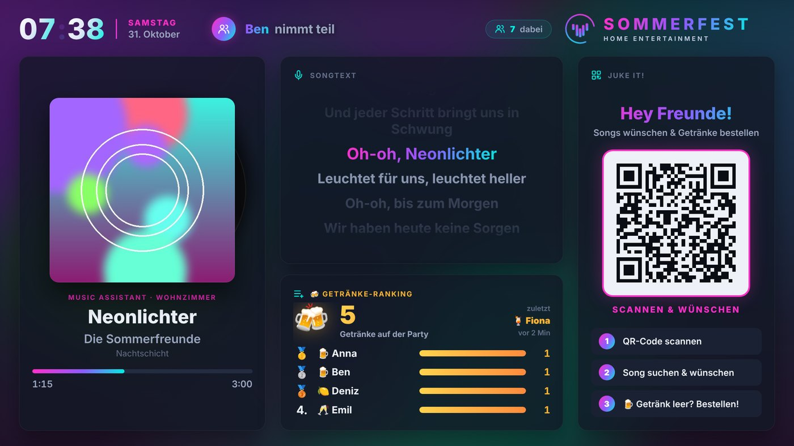
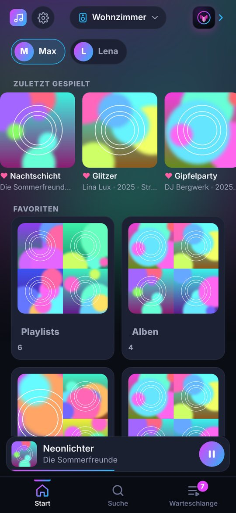
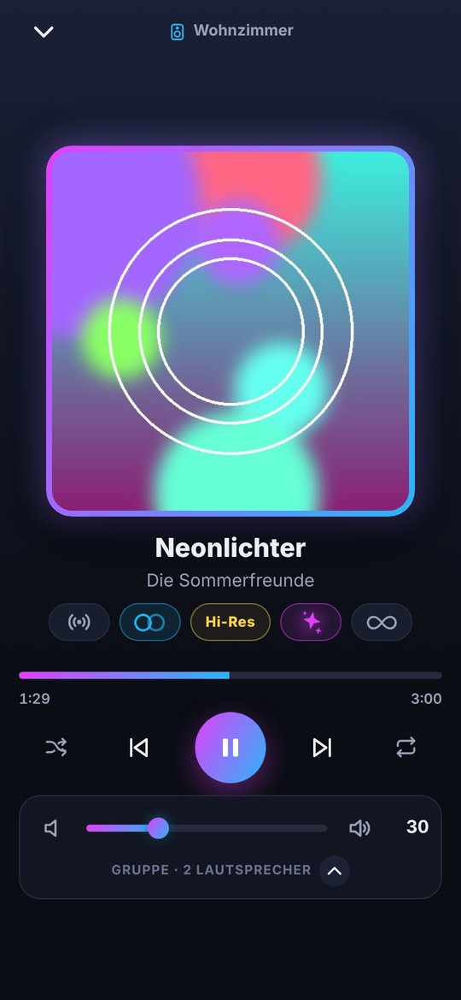
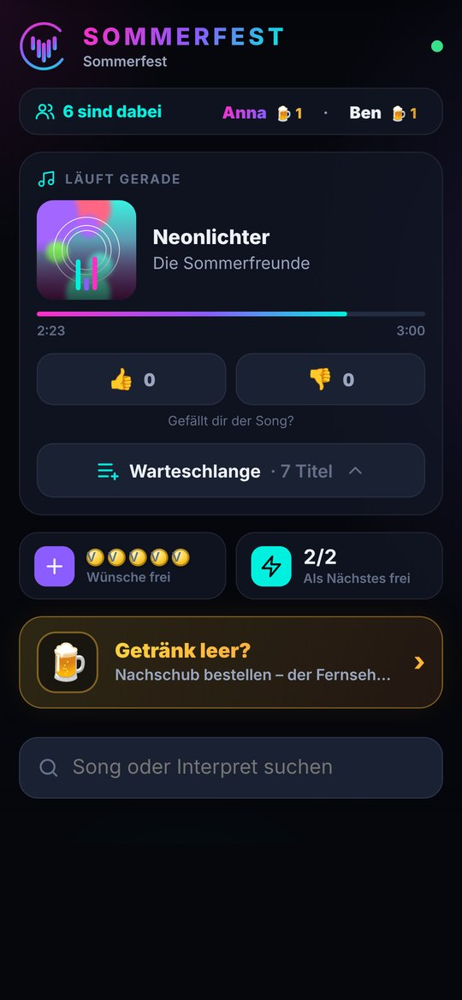
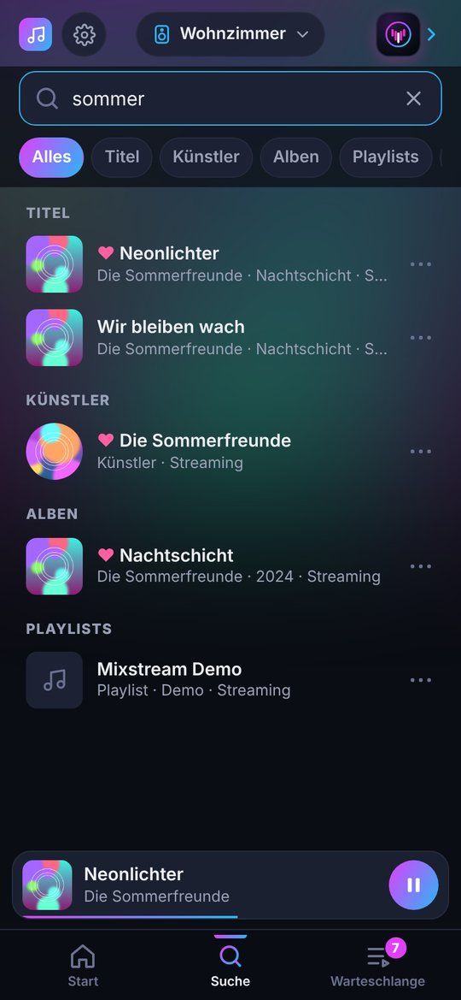
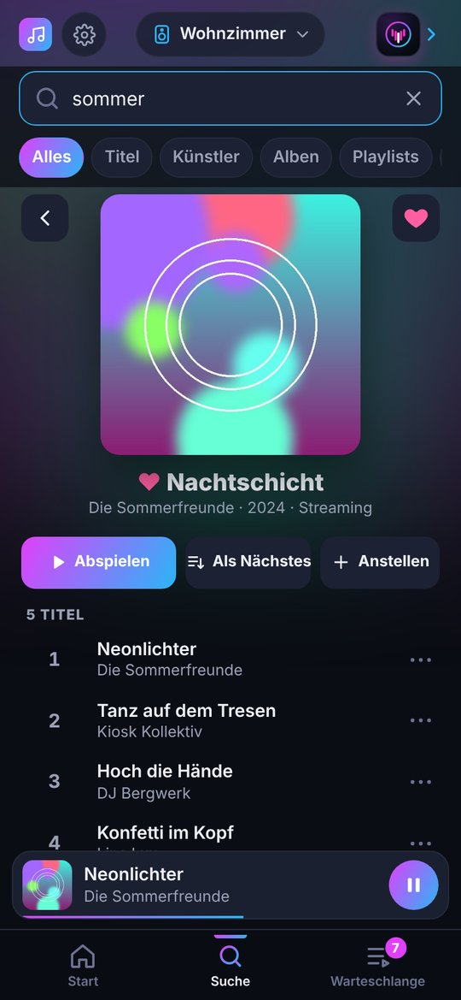
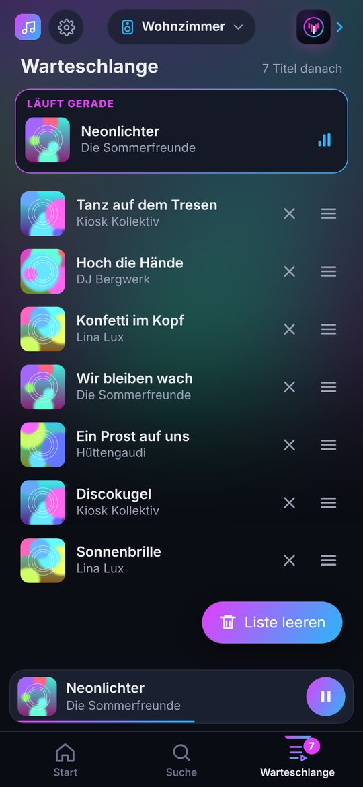
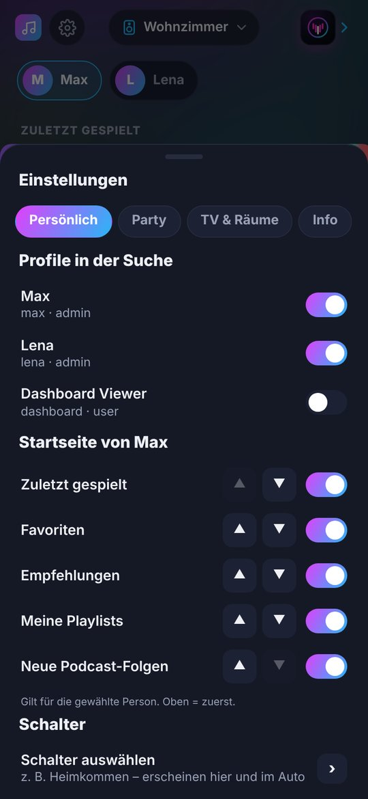
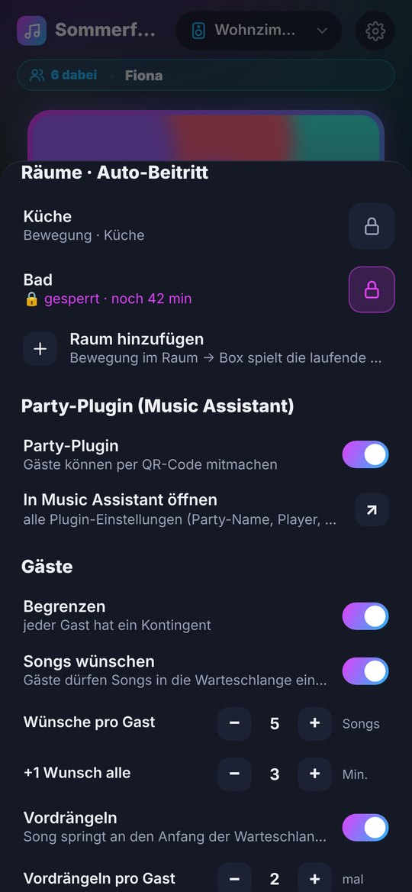
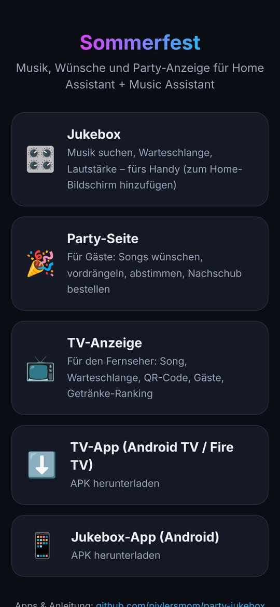

# 🎉 Party-Jukebox

Home-Assistant-Add-on für Partys und den Alltag mit **Music Assistant**: eine Jukebox fürs Handy, eine Party-Seite für Gäste und eine Anzeige für den Fernseher – alles aus einem Add-on, ohne YAML.

  

| Jukebox – Startseite | Player (aufgeklappt) | Party-Seite (Gäste) |
|:---:|:---:|:---:|
|  |  |  |

---

## Was kann es?

### 🎛️ Jukebox (für dich)
- Suchen nach Titeln, Künstlern, Alben, Playlists, Radio, Podcasts und Hörbüchern. Künstler, Alben, Playlists und Podcasts lassen sich öffnen (großes Cover) und durchklicken. Unter jedem Eintrag steht die Quelle (z. B. Tidal, Spotify, TuneIn).
- Warteschlange: Titel per Griff ≡ verschieben, entfernen, als Nächstes einreihen oder **hinten anstellen** (hinter die eigenen Wünsche, automatisch ergänzte Titel bleiben dahinter). Oben steht, aus welcher Playlist bzw. welchem Album die Musik gerade kommt. Die Warteschlange ist auch direkt aus dem Player erreichbar.
- **Sprachsuche**: 🎤 rechts im Suchfeld (auch auf der Party-Seite)
- Eine Playlist oder ein Album abspielen ersetzt die Warteschlange
- **Eigene Playlists**: neue Playlist anlegen (Suche → „＋ Neue Playlist“), Titel über das Titel-Menü oder den ＋-Knopf im Player hinzufügen, die Warteschlange als Playlist speichern, Titel wieder entfernen. Gespeichert wird beim Musikdienst des Profils (erscheint dann auch in dessen App) oder in Music Assistant.
- **Hörfortschritt** bei Podcast-Folgen und Hörbüchern („noch 12 min“, „✓ gehört“, Balken)
- Lautsprecher wählen und gruppieren; die Lautstärke regelst du für die ganze Gruppe oder für jede Box einzeln. In der Lautsprecher-Liste zeigt jede Box, auf der etwas läuft, das Cover (bzw. Sender-/App-Logo beim TV-Ton).
- **Cover antippen** → Songtext läuft mit · **Cover lange drücken** → laufender Titel zu den Favoriten (Rahmen im Farbverlauf)
- **Startseite** wie bei Spotify: Zuletzt gespielt, Favoriten (Kacheln je Art, antippen = Liste mit Suchfeld), Empfehlungen, Meine Playlists, neue Podcast-Folgen. Die Leiste unten hat Start · Suche · Warteschlange.
- **Player zum Aufklappen**: Mini-Leiste antippen → großes Cover mit Steuerung; ⌄, nach unten wischen oder Zurück klappt ihn zu
- **Favorit speichern**: ♥ oben rechts bei Playlist/Album/Künstler oder Cover lange drücken
- **Ab hier abspielen**: in einer Playlist (z. B. mit allen Hörspiel-Folgen) per Suchfeld die Folge finden, antippen → „Playlist ab hier“ – der Rest der Liste folgt
- Ein Podcast zeigt seine Folgen (neueste zuerst, mit Datum und „gehört“)
- **Mehrere Personen**: oben auf der Startseite die Person wählen – Favoriten, Zuletzt gespielt, Empfehlungen und Playlists gehören dann zu ihr (eigene Musikquellen in Music Assistant)
- Teilnehmer-Laufband: wer gerade auf der Party ist
- **Liste leeren**: schwebender Knopf in der Warteschlange – kommende Titel oder alles entfernen
- In der Android-App: Player in der Benachrichtigung und auf dem Sperrbildschirm, Lautstärketasten regeln die Musik, Start-Sound, **Update direkt aus der App**

| Suche | Album geöffnet | Warteschlange |
|:---:|:---:|:---:|
|  |  |  |

### 🥳 Party-Seite (für Gäste)
Gäste scannen den QR-Code auf dem Fernseher und können:
- Songs wünschen (mit Widmung „für …“), sich vordrängeln
- über den laufenden Song abstimmen (👎-Mehrheit überspringt)
- Getränke-Nachschub bestellen – auf Wunsch kommt eine Nachricht aufs Handy

### 📺 TV-Anzeige
Aktueller Song mit Songtext (zeitgenau), Warteschlange, „Als Nächstes“, QR-Code, neue Gäste, Getränke-Ranking und Nachschub-Hinweise.

### 🔈 TV-Ton (Soundbar mit TV-Eingang, z. B. Sonos Beam)
- In der **Lautsprecher-Liste** hat jede Box mit TV-Eingang einen Umschalter **♪ Music / 📺 TV**
- Die Jukebox erkennt den TV-Ton auch, wenn die Soundbar von selbst umschaltet (sie fragt die Sonos direkt)
- Im Player stehen dann Sender bzw. App, Sendung und Bild statt eines Songs; Musik-Knöpfe werden ausgeblendet
- **Mit der TV-App auf der TV-Box** (Android TV / Google TV): Bild der Sendung, Laufzeit und **Restzeit**, **Play/Pause** und **Spulen** am Balken. Dafür braucht die TV-App einmalig den Zugriff auf Mediensitzungen – per ADB:
  `adb shell cmd notification allow_listener de.partyjukebox.tv/de.partyjukebox.tv.MediaListener`
  Für Play/Pause die Box unter `tv_box_entities` eintragen (siehe Optionen).

### ⚙️ Einstellungen direkt in der Jukebox
Zahnrad oben links – in Reitern **Persönlich · Party · TV & Räume · Info**:
- **Lichteffekte** an/aus (eigene HA-Skripte bei Wunsch, Vordrängeln, Nachschub – [Vorlagen](lichteffekte/))
- **Abstimmung** an/aus, **Gast-Limits** (Wünsche und Vordrängeln pro Gast, Nachfüllzeit)
- **TV-Anzeige**: Songtext-Versatz, volle Optik oder Spar-Modus für langsame Geräte
- **Räume · Auto-Beitritt**: Lautsprecher + Bewegungsmelder je Raum – wer den Raum betritt, hört die laufende Musik mit, ohne Bewegung trennt sich die Box wieder. Sperre per Schloss (mit Restzeit), optional über einen eigenen HA-Schalter (z. B. für Alexa)
- **Party-Plugin** von Music Assistant installieren, ein- und ausschalten
- **Push bei neuen Podcast-Folgen** (pro Person): sobald **Android Auto oder CarPlay** aktiv wird, prüft das Add-on einmal die ♥-Podcasts – bei einer neuen, ungehörten Folge kommt eine Benachrichtigung über die Home-Assistant-App (Handy, Uhr, Autodisplay) mit Cover und Knopf **„Jetzt abspielen“**. Auslöser ist ein Sensor der HA-App: *Android Auto* (Android), *Bluetooth-Verbindung* mit Suchtext (z. B. Autoname) oder *Audio-Ausgabe* = „CarPlay“ (iPhone)
- **Startseite pro Person**: Reihenfolge der Reihen (Zuletzt gespielt, Favoriten, Empfehlungen, Meine Playlists, Neue Podcast-Folgen) mit ▲▼ festlegen, einzelne Reihen ausblenden
- **Schalter**: eigene Home-Assistant-Schalter direkt in der Jukebox schalten (z. B. „Musik beim Heimkommen“). Unter „Schalter auswählen“ stehen zuerst deine **Helfer** (`input_boolean`) – die legst du in HA unter *Einstellungen → Geräte & Dienste → Helfer → Schalter* an und nutzt sie in deinen Automationen als Bedingung. Über das **Suchfeld** findest du auch alle anderen Schalter (`switch.*`). Es erscheinen nur die Schalter, die du auswählst – ohne Auswahl bleibt der Bereich leer.

| Einstellungen (Reiter) | Räume · Auto-Beitritt |
|:---:|:---:|
|  |  |

---

## Voraussetzungen

- Home Assistant OS oder Supervised (Add-ons müssen möglich sein)
- [Music Assistant](https://www.music-assistant.io/) ab 2.x als Add-on
- Lautsprecher, die in Music Assistant eingebunden sind (Sonos, AirPlay, Chromecast …)

## Installation

1. In Home Assistant: **Einstellungen → Add-ons → Add-on Store → ⋮ → Repositories**
2. URL hinzufügen: `https://github.com/pivlersmom/party-jukebox`
3. **Party-Jukebox** installieren
4. Im Reiter **Konfiguration** den **Music-Assistant-Token** eintragen
   (Music Assistant → Einstellungen → Profil → Token erstellen)
5. Add-on starten → **Web-UI öffnen** (oder im Heimnetz `http://<HA-IP>:8099`)
6. In der Jukebox ⚙ → **Party-Plugin → Installieren** (für QR-Code und Gäste-Anmeldung)

## Optionen (Add-on-Konfiguration)

| Option | Bedeutung |
|---|---|
| `ma_url` | Leer lassen = Music-Assistant-Add-on wird automatisch gefunden |
| `ma_token` | Token aus Music Assistant (Pflicht) |
| `party_name` | Titel auf TV und Party-Seite |
| `party_player` | MA-Player für die Party (leer = der gerade spielende) |
| `notify_service` | z. B. `notify.mobile_app_mein_iphone` – Nachschub-Bestellungen aufs Handy/die Uhr, Android und iPhone; mehrere mit Komma trennen (leer = aus) |
| `script_wish` / `script_boost` / `script_drink` | Optionale HA-Skripte, z. B. Lichteffekte – fertige Vorlagen im Ordner [`lichteffekte`](lichteffekte/) |
| `skip_votes` | Song überspringen, wenn die Mehrheit der Gäste 👎 stimmt |
| `drinks` | Getränkeliste, je Zeile `Name|Emoji|Satz` (z. B. `Bier|🍺|ein Bier`) |
| `tv_cast_entity` | Optional: Cast-Player der TV-Box – liefert Sender und Sendung für den TV-Ton |
| `tv_box_entities` | Optional: weitere Player der TV-Box (Android TV, Fire TV …), mit Komma getrennt – App-Name; der erste wird für Play/Pause im TV-Modus genutzt |
| `tv_logo_index` / `tv_logo_dir` | Optional: Senderlogos unter `/local` (JS-Datei `{"sendername": "datei.png"}` und Ordner der Logos) |
| `app_update_repo` / `app_update_token` | Optional: eigene App-Builds aus einem GitHub-Repo anbieten (Token nur bei privatem Repo). Leer lassen = Apps aus diesem Add-on |
| `app_update_package` | Optional: App-Kennung (z. B. `de.partyjukebox.player`). Bei neuer App-Version kommt eine Benachrichtigung über die HA-App (Handys aus dem Podcast-Push); Antippen öffnet die App |
| `dmx_host` | Optional: Adresse eines Art-Net-Knotens (z. B. ESP32 mit [LuxDMX](https://github.com/tombueng/LuxDMX)). Dann läuft ein DMX-Licht im Takt der Musik – die Beat-Daten kommen direkt aus Music Assistant, ohne Mikrofon. Leer = aus |
| `dmx_universe` | Art-Net-Universum (Standard 0) |
| `dmx_channels` | Kanäle der Lampe, z. B. `dimmer=1,r=2,g=3,b=4,w=5`; feste Werte als `6=255` |
| `dmx_player` | Lautsprecher (Name oder ID), dem das Licht folgt (leer = Party-Player) |
| `dmx_effect` | `beat` (Puls auf jeden Schlag), `smooth` (folgt der Lautstärke) oder `color` (nur Farbwechsel) |
| `dmx_delay_ms` | Feinabgleich: positiv = Licht später, negativ = früher |

Alles Weitere (Limits, Räume, TV-Darstellung) stellst du in der Jukebox unter ⚙ ein.

## Geräte

| | iPhone / iPad | Android | Fernseher |
|---|---|---|---|
| **Jukebox** | Safari → `…:8099/jukebox.html` → Teilen → *Zum Home-Bildschirm* | Jukebox-APK (aktualisiert sich selbst) oder Chrome → *App installieren* | – |
| **Party-Seite** | QR-Code vom TV scannen | QR-Code vom TV scannen | – |
| **TV-Anzeige** | – | – | Android-TV-Box / Fire TV mit TV-APK, oder Browser auf `…:8099/tv.html` |

**Fernseher im Detail**
- **Android TV / Google TV / Fire TV** (auch Sony, Philips, TCL …): TV-App (APK) installieren – startet automatisch, bleibt an, holt sich Updates selbst. Optional meldet sie, was auf der Box läuft (siehe TV-Ton).
- **Samsung (Tizen):** eigene App im Ordner [`tizen-tv`](tizen-tv/) – Installation über den Entwicklermodus, Anleitung dort. Oder einfach den Browser.
- **LG (webOS) und alle anderen:** im Browser des Fernsehers `http://<IP>:8099/tv.html` öffnen, **OK / Enter = Vollbild**.
- Günstige Alternative für jeden Fernseher: ein Streaming-Stick (Fire TV / Google TV) am HDMI-Anschluss mit der TV-App.

Die Apps gibt es unter [Releases](https://github.com/pivlersmom/party-jukebox/releases) und direkt auf der Startseite des Add-ons.

## Sicherheit

- Die Seiten sind im Heimnetz erreichbar (Port 8099). **Gastgeber-PIN** (Jukebox → ⚙ → Gastgeber-PIN): Jukebox, Einstellungen und Vollzugriff auf Music Assistant nur nach PIN, das Gerät bleibt angemeldet. Gäste-Seite und TV-Anzeige bleiben frei. Auf der Gäste-Seite führt **Logo lange drücken** zur PIN-Abfrage. Ohne PIN kann jeder im WLAN die Jukebox öffnen.
- Der Browser bekommt **keinen Zugriff auf Home Assistant**. Gäste können nichts im Haus steuern – HA nutzt nur das Add-on selbst (Skripte, Benachrichtigungen, Bewegungsmelder der eingetragenen Räume, die unter „Schalter“ ausgewählten Schalter – nur für den Gastgeber).
- Gäste in einem getrennten Gäste-WLAN erreichen die Seiten nicht. Port 8099 **nicht** ins Internet freigeben.

## Unterstützen

Gefällt dir die Party-Jukebox? Über eine freiwillige Unterstützung freue ich mich:

Freiwillig und ohne Gegenleistung – die Party-Jukebox bleibt kostenlos.

## Lizenz

© 2026 pivlersmom – **Alle Rechte vorbehalten.** Installation und private Nutzung sind erlaubt;
Änderungen, Weitergabe veränderter Fassungen und kommerzielle Nutzung nur mit Zustimmung.
Nutzung auf eigene Gefahr. Details: [LICENSE](LICENSE).

Verwendet den QR-Code-Generator von Kazuhiko Arase (MIT-Lizenz).

Screenshots mit Demo-Daten (erfundene Titel und Cover).
